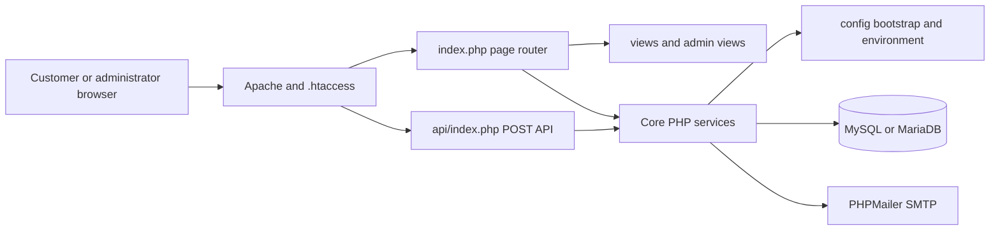
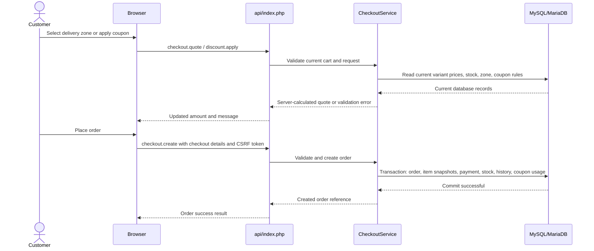
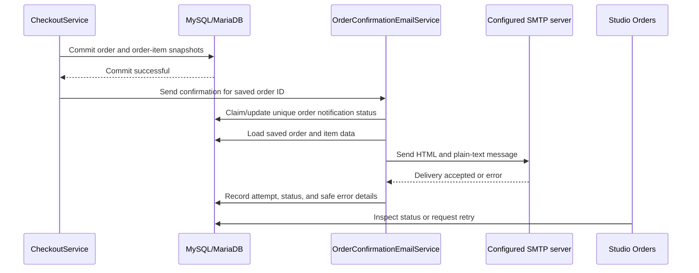
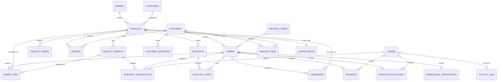

# THE LAST NOTE BD (Perfume E-Commerce)

THE LAST NOTE BD is a server-rendered perfume storefront and administration studio built with Core PHP and MySQL/MariaDB. It supports catalogue browsing, guest and customer shopping, checkout, order tracking, and staff-managed store operations. The project is designed to run on Apache/XAMPP and does not require a frontend framework or JavaScript build process.

> **Project status:** This README documents the application as currently implemented. Payment-provider automation, a server-side contact form, newsletter campaigns, and product-level sale-price fields are not currently part of the application.

## Contents

- [Project overview](#project-overview)
- [Users and permissions](#users-and-permissions)
- [Features and pages](#features-and-pages)
- [Technology and architecture](#technology-and-architecture)
- [Project structure](#project-structure)
- [Application workflows](#application-workflows)
- [API actions](#api-actions)
- [Database model](#database-model)
- [Installation](#installation)
- [Configuration](#configuration)
- [Security and privacy](#security-and-privacy)
- [Testing and verification](#testing-and-verification)
- [Known limitations and future work](#known-limitations-and-future-work)
- [Troubleshooting](#troubleshooting)
- [Project team](#project-team)
- [Further documentation](#further-documentation)

## Project overview

### Purpose

The project provides a small fragrance house with a branded online shop and a private studio for managing its products and day-to-day order operations. Customers can discover fragrances, choose a size, manage a bag, and place or track an order without requiring an account. Optional customer accounts provide saved addresses and order history.

### Problem addressed

The application brings catalogue discovery, stock-aware shopping, delivery-zone pricing, coupon validation, checkout, order tracking, and staff workflows into one PHP application. Order and price decisions are validated on the server against current database records rather than trusted from browser-submitted totals.

### Objectives

- Present THE LAST NOTE BD products and fragrance information in a responsive storefront.
- Support guest and registered-customer purchase flows.
- Keep order totals, inventory, coupons, and delivery fees consistent with the database.
- Give administrators tools for catalogue, order, payment-review, inventory, content, and reporting tasks.
- Send a transactional order confirmation after an order has committed, when SMTP is configured.

### Scope

Included: storefront pages, customer accounts, session cart, checkout and order creation, order lookup/cancellation where eligible, manually reviewed payment records, staff studio, database-backed store settings/content, and optional SMTP confirmation.

Not included: card processing, automatic bKash/Nagad provider verification, automatic refunds, a shipment-carrier integration, or a full marketing/newsletter platform.

## Users and permissions

| User type | Capabilities |
|---|---|
| Guest | Browse/search/filter products, use a session cart and wishlist, submit checkout details, place an order, and look up an order using its reference and checkout phone number. Eligible cancellation is subject to order status and the configured cancellation window. |
| Registered customer | Guest shopping capabilities plus sign-in, profile management, saved delivery addresses, account order history, and database-backed wishlist items. |
| Administrator | Sign in to the Studio to manage products, variants, stock, orders, payment verification, reviews, discounts, customers, delivery zones, homepage content, limited drops, pre-orders, settings, and reports. |

The current application has a customer account and an administrator account. It does not implement a separate role/permission matrix for multiple administrator roles.

## Features and pages

### Storefront pages

Public page routing is handled by the root [`index.php`](index.php).

| Page / route | Purpose and implemented behavior |
|---|---|
| `home` | Brand landing page with a database-configured hero, promotional banners, configured product sections, limited-release products, featured reviews, brand story, scent-finder link, and social links. |
| `shop` | Shop All catalogue with search, supported filters, product count, sort control, pagination, and a responsive filter drawer. |
| `product` | Product detail, fragrance notes, images, size/variant and stock selection, reviews, and add-to-bag/wishlist actions. |
| `cart` | Session shopping bag with quantity and variant changes, coupon entry/removal, totals, and optional WhatsApp inquiry. A WhatsApp inquiry does not create an order. |
| `checkout` | Customer/contact and delivery details, delivery-zone selection, payment method, server-validated quote, coupon, and final order submission. |
| `success` | Order confirmation result. Refreshing this page does not itself send another email. |
| `track` | Guest order lookup and eligible cancellation using the order reference and matching checkout phone number. |
| `login`, `register`, `account` | Customer authentication, registration, profile, saved addresses, and account order history. |
| `wishlist` | Saved products; guests use session state and signed-in customers use `wishlist_items`. |
| `mood` | Scent finder based on product fragrance-family/note text and available occasion/mood tags. Scent intensity is not stored and is not a working filter. |
| `discovery-sets` | Discovery-set product selection/listing. |
| `about` | Brand story and fragrance-house information. |
| `contact` | Store-configured email/phone contact details. Its form opens the visitor's email application with a `mailto:` message; the website does not store or send the submission. |
| `delivery` | Active zones, fees, estimated delivery windows, cancellation information, and current return/refund limitations. |
| `faq` | Frequently asked questions. |

The `For Her`, `For Him`, and `Unisex` catalogue links use the Shop route with a gender filter; they are not separate page implementations. The site footer includes navigation, contact/social details, and a newsletter subscription form.

### Shop sorting and filter behavior

Sorting and filters use the existing server-side catalogue service. Implemented sort choices include recommended/featured, popular, newest, price low-to-high, and price high-to-low. A best-rated sort is not currently implemented. Applying filters and sorting preserves the active search/filter query and resets pagination as appropriate.

Filters are limited to the data and options currently supported by the catalogue service; they include catalogue text search and product facets such as gender, brand/category, fragrance family, price, and availability. The exact filter set is generated from active catalogue data.

### Administrator Studio

The private entry point is `admin/index.php?page=login`. Studio pages are protected by the administrator session.

| Studio page | Main purpose |
|---|---|
| Dashboard | Order/payment overview, sales summary, low-stock count, notifications, and recent activity. |
| Products | Product details, brands/categories, product images, and variant information. |
| Orders | Order search/status, order details/history, payment review, and confirmation-email status/retry. |
| Inventory | Variant stock levels, low-stock thresholds, and stock adjustment history. |
| Reviews | Review moderation and featured-review management. |
| Discounts | Coupon creation, limits, dates, eligibility, and product scope. |
| Settings | Store settings, administrator profile/password, categories, and brands. |
| Customers | Registered-customer and guest-order customer summaries; customer account activation controls. |
| Content | Hero/promo/popup banners, homepage sections, and social links. |
| Delivery | Delivery-zone charges, estimated timing, and instructions. |
| Drops | Limited-release schedule and stock/pre-order options. |
| Pre-orders | Pre-order status and expected ship-date updates. |
| Reports | Date-filtered sales reporting and CSV export. |
| Activity | Recent administrator activity log. |

## Technology and architecture

### Technology stack

| Layer | Implementation |
|---|---|
| Application | Core PHP, server-rendered HTML templates |
| Database | MySQL or MariaDB, accessed through PDO and prepared statements |
| Browser | HTML5, custom CSS, vanilla JavaScript, and Fetch API |
| Web server | Apache with `.htaccess` rewrite/protection rules |
| Session | PHP sessions for authentication, cart, and guest wishlist state |
| Transactional email | PHPMailer over authenticated SMTP, installed with Composer |
| Charts | Chart.js for Studio reporting/dashboard presentation |

No React, Vue, Angular, Laravel, Next.js, Node.js build, or frontend bundler is required. Google Fonts and the Studio chart library may be requested from external hosts by the browser.

### Request and application architecture



The public router selects an allow-listed page and renders its view. Form and asynchronous actions post to the same-origin API. Services contain the catalogue, cart, checkout, and order-email operations. Configuration loads environment settings and creates the PDO connection. The checkout service is authoritative for server-side prices, stock, coupons, delivery charges, and order totals.

## Project structure

```text
.
├── .env.example                 Safe configuration template
├── .gitignore                   Excludes local/private and generated files
├── .htaccess                    Rewrite rules and direct-access protections
├── README.md                    This guide
├── README_EX.md                 Additional project README
├── index.php                    Public page router
├── composer.json                PHP dependency manifest
├── composer.lock                Locked PHP dependency versions
├── admin/                       Administrator Studio entry point and views
├── api/
│   └── index.php                Same-origin POST actions and JSON responses
├── assets/
│   ├── css/                     Storefront and Studio styling
│   ├── js/                      Vanilla JavaScript interactions
│   ├── images/                  Product and brand imagery
│   └── uploads/                 Product images uploaded through the Studio
├── config/                      Environment/bootstrap and PDO configuration
├── database/
│   ├── perfume_ecommerce.sql    Fresh-install schema, views, and starter data
│   ├── maison_serein_demo_seed.sql
│   └── migrations/              Additive changes for existing installations
├── docs/                        Installation, architecture, and project notes
├── includes/                    Shared bootstrap, header/footer, and helpers
├── scripts/
│   └── create-admin.php         Interactive CLI administrator creation
├── services/                    Store, cart, checkout, and email services
├── tests/
│   └── smoke.php                Database/schema/configuration smoke checks
├── vendor/                      Composer dependencies (generated/ignored)
└── views/                       Public storefront page templates
```

`vendor/` is generated by Composer and should not be maintained manually. The root `.env` is machine-specific and must remain private.

## Application workflows

### Catalogue discovery

1. The router loads the requested public page and shared bootstrap.
2. Catalogue requests are handled by the store service, which queries active products, variants, images, and related brand/category data.
3. Search, filters, sorting, and pagination are applied by the existing server-side query logic.
4. Product cards and details render current variant price and availability from the database.

### Cart and wishlist

- Guest cart and wishlist data are held in the PHP session.
- Signed-in customer wishlist entries are stored in `wishlist_items`; customer addresses and orders are database-backed.
- Cart quantity and selected variant are rechecked against current product/variant data at checkout.
- Optional WhatsApp cart/product links are inquiries only and do not reserve stock or create an order.

### Checkout, coupons, and payment



The checkout calculation uses the saved/current variant selling price as the product price. The order total is calculated as:

```text
Final payable = product subtotal - coupon discount + delivery charge
```

The product subtotal already reflects the applicable variant price. A separate product-level original/offer price is not modeled in the current schema, so the application cannot produce a product-discount line from a stored sale-price comparison. Coupon eligibility and discount amounts are recalculated on the server; browser values are display-only.

Coupons support the configured percentage/fixed type, date window, minimum purchase, optional maximum discount, product scope, first-order eligibility, active flag, and usage limit. Usage is recorded with the order. The checkout quote updates after coupon or delivery-zone changes.

Supported payment methods are bKash, Nagad, and cash on delivery, subject to store configuration. For bKash/Nagad, a customer may provide a transaction ID and an administrator reviews the payment record. The application does not connect to either provider's verification API and does not accept card details.

### Order-confirmation email



Email is attempted only after the order transaction commits. A send failure does not roll back or invalidate the order. The unique notification record keyed by order prevents a success-page refresh from sending another message; failed sends can be retried by an administrator. The message is built from saved order and order-item values, not frontend totals. Product images are included only when a reliable public HTTPS URL can be formed from `APP_URL`.

### Administrator operations

Administrators authenticate through the Studio. Protected API actions check the administrator session and CSRF token, then update the relevant records. Order state changes are written to order history; inventory adjustments are recorded as inventory transactions. Payment verification is an administrative action, not an external provider callback.

## API actions

All actions are POSTed to `api/index.php`, use same-origin requests, and return JSON responses. Mutating requests use the application's CSRF token. Admin actions require an administrator session.

| Area | Actions |
|---|---|
| Cart and wishlist | `cart.add`, `cart.update`, `cart.change-variant`, `cart.remove`, `wishlist.toggle` |
| Checkout and customer order | `checkout.quote`, `checkout.create`, `discount.apply`, `discount.remove`, `track.lookup`, `track.cancel` |
| Customer account | `customer.register`, `customer.login`, `customer.logout`, `customer.profile.update`, `customer.address.save`, `customer.address.delete`, `customer.address.default` |
| Public engagement | `newsletter.subscribe`, `review.submit` |
| Studio authentication/profile | `admin.login`, `admin.logout`, `admin.profile.update`, `admin.password.change` |
| Catalogue/settings | `admin.product.save`, `admin.product.visibility`, `admin.product.active`, `admin.variant.save`, `admin.variant.toggle`, `admin.category.save`, `admin.category.toggle`, `admin.brand.save`, `admin.brand.toggle`, `admin.setting.save` |
| Orders, payment, inventory | `admin.order.update`, `admin.order.email.retry`, `admin.payment.update`, `admin.stock.threshold`, `admin.stock.adjust` |
| Content and store operations | `admin.discount.save`, `admin.discount.toggle`, `admin.review.moderate`, `admin.notification.read`, `admin.customer.toggle`, `admin.banner.save`, `admin.social.save`, `admin.section.save`, `admin.section.toggle`, `admin.delivery.save`, `admin.drop.save`, `admin.preorder.update` |

The API is a PHP action endpoint, not a separately versioned public REST API. It should not be exposed as an unauthenticated integration interface.

## Database model

The fresh-install script [`database/perfume_ecommerce.sql`](database/perfume_ecommerce.sql) creates 28 application tables and two views. Tables use InnoDB and `utf8mb4`; the database is the source of truth for products, variants, stock, coupons, orders, and delivery zones.

### Main entities and important fields

| Entity | Purpose and notable attributes |
|---|---|
| `admins` | Studio credentials/profile, password hash, active state, and last-login information. There is no separate roles table. |
| `customers` | Customer name, email, normalized phone, password hash for registered users, active state, and timestamps. Guest orders may have no linked customer record. |
| `customer_addresses` | Saved customer address, recipient/phone, district, default selection, and address details. Delivery zone is selected separately during checkout. |
| `brands`, `categories` | Catalogue grouping metadata such as name, slug, description, active state, and sort order. |
| `products` | Product name/slug, brand and optional category, gender, descriptions, fragrance family/notes, mood tags, and featured/best-seller/new/active flags. |
| `product_variants` | SKU, product link, size, current unit price, stock quantity, low-stock threshold, sort order, and active state. A separate original/sale-price pair is not present. |
| `product_images` | Product image path, alt text, and display order. |
| `delivery_zones` | Zone name, delivery fee, estimated days, instructions, and ordering/active state. |
| `orders` | Order number and unique request/idempotency reference, optional customer and zone, checkout contact/address snapshots, payment/order statuses, subtotal/discount/delivery/grand totals, and timestamps. Coupon usage links to `discount_usage`; the code is not duplicated as an order column. |
| `order_items` | Product/variant references where retained, plus saved product name, size, unit price, quantity, and line total for order history/email. |
| `payments` | Order, method, transaction ID, amount, verification status, verifying administrator, and administrative note. |
| `order_status_history` | Order status changes, notes, optional administrator, and timestamp. |
| `order_email_notifications` | Unique per-order send state, attempt count/times, sent time, and safe last-error details. |
| `inventory_transactions` | Variant, optional order/admin, signed quantity change, reason, note, and timestamp. |
| `discounts`, `discount_usage` | Coupon code/type/value, purchase/date/usage limits, first-order/product scope, and use records tied to order and normalized phone. |
| `reviews` | Product, optional customer, displayed customer name, rating, title/body, moderation state, and featured flag. |
| `wishlist_items` | Unique customer/product saved item. The `wishlists` view exposes its basic fields. |
| `banners`, `homepage_sections`, `social_links` | Database-managed homepage content, placement/collection keys, ordering, activation, and social URLs. |
| `store_settings` | Key/value configuration for payment instructions, contact details, cancellation window/policy, and other store options. |
| `limited_drops`, `preorders` | Scheduled product releases and optional pre-order fulfillment/status data. |
| `notifications`, `activity_logs` | Studio notifications and administrator activity records. |
| `newsletter_subscribers` | Unique email and subscribed/unsubscribed state. Subscription is stored; campaign delivery is not implemented. |
| `inventory` | Database view that presents inventory data from product variants. |

There is no dedicated `collections` table. Product groupings are represented by categories, product flags, and `homepage_sections.collection_key`.

### Entity relationships

The diagram below shows declared foreign-key relationships and important optional links. Some entities such as banners, settings, social links, and newsletter subscribers are intentionally independent.



## Installation

### Requirements

- Windows/XAMPP or another Apache/PHP/MySQL environment.
- PHP 8.1+ with PDO MySQL, OpenSSL, `mbstring`, `iconv`, `fileinfo`, and GD enabled.
- MySQL 8+ or MariaDB 10.6+.
- Apache `mod_rewrite` and `.htaccess` overrides enabled.
- Composer for PHPMailer and email functionality.

The storefront does not require Node.js or a frontend build. PHPMailer is installed by Composer; the locked dependency is recorded in `composer.lock`.

### Fresh local setup (XAMPP)

1. Place the project at `C:\xampp\htdocs\perfume-ecommerce`.
2. Start Apache and MySQL in the XAMPP Control Panel.
3. Create an empty database named `maison_serein` using `utf8mb4_unicode_ci`.
4. Import [`database/perfume_ecommerce.sql`](database/perfume_ecommerce.sql) into that empty database.
5. Copy `.env.example` to `.env` in the project root and set the local database values.
6. From the project root, install the locked PHP dependencies:

   ```powershell
   composer install
   ```

7. Create the first Studio administrator interactively:

   ```powershell
   C:\xampp\php\php.exe scripts\create-admin.php
   ```

   The script prompts for the administrator details. Do not put an administrator password in a command-line argument.

8. Open the storefront at `http://localhost/perfume-ecommerce/`.
9. Open the Studio at `http://localhost/perfume-ecommerce/admin/index.php?page=login`.
10. Configure real contact/payment details and product content in the Studio before accepting live orders.

> **Important database warning:** `database/perfume_ecommerce.sql` is a fresh-install script that drops and recreates application tables. Do not import it over a database containing orders or customer data. Back up existing data and apply only the appropriate additive migration(s), such as [`database/migrations/2026_11_27_order_email_notifications.sql`](database/migrations/2026_11_27_order_email_notifications.sql).

The fresh-install SQL includes the email notification table. Existing installations must run the order-email migration once before using email status tracking and retry in the Studio.

### Deployment notes

- Set `APP_URL` to the canonical public HTTPS origin, with the correct application base path if installed in a subdirectory.
- Use a private `.env` file and a database user with only the permissions the app needs.
- Enable HTTPS; ensure PHP's secure-session cookie behavior is active through HTTPS.
- Keep PHP errors out of public responses and inspect the server error log instead.
- Ensure `assets/uploads/` is writable only as required for uploads, and configure the web server to prevent execution of uploaded files.
- Verify that the production SMTP sender/domain is authorized and that production product images are publicly reachable over HTTPS.

## Configuration

The environment loader reads the root `.env`. Never publish `.env` or use real secrets in `.env.example`.

### Database and application settings

| Variable | Purpose | Typical local value |
|---|---|---|
| `APP_NAME` | Store name shown in shared page chrome. | `THE LAST NOTE BD` |
| `APP_TIMEZONE` | PHP default timezone for date/time operations. | `Asia/Dhaka` |
| `APP_URL` | Public base URL used when building email image links. | `http://localhost/perfume-ecommerce` |
| `DB_HOST` | MySQL/MariaDB host. | `127.0.0.1` |
| `DB_PORT` | MySQL/MariaDB port. | `3306` |
| `DB_NAME` | Application database name. | `maison_serein` |
| `DB_USER` | Database username. | Local XAMPP commonly uses `root` |
| `DB_PASSWORD` | Database password. | Set to the local DB password; XAMPP may initially use empty |

`APP_CURRENCY` is defined from the environment, but current money formatting is not a complete multi-currency feature and displays Bangladeshi taka. Do not assume changing this value converts stored prices or all UI formatting. The sample `APP_ENV`/`APP_DEBUG` entries are not runtime error-handling controls in the current PHP code.

### SMTP / Brevo setup

Email is optional. Configure a verified sender and Brevo **SMTP** credentials in the private `.env`; a Brevo API key is not an SMTP password.

```dotenv
MAIL_HOST=smtp-relay.brevo.com
MAIL_PORT=587
MAIL_USERNAME=your-brevo-smtp-login
MAIL_PASSWORD=your-brevo-smtp-key
MAIL_ENCRYPTION=tls
MAIL_FROM_ADDRESS=verified-sender@example.com
MAIL_FROM_NAME="THE LAST NOTE BD"
```

In Brevo, create or locate the SMTP key and SMTP login, verify the sender/domain, then copy those values into `.env`. Do not place credentials in PHP, JavaScript, HTML, screenshots, issue reports, or a committed environment file. If an SMTP credential has ever been exposed, revoke/rotate it with the provider.

When mail is not configured or SMTP fails, the order remains successful. The customer is not told that an email was sent unless the send succeeds; administrators can inspect and retry eligible failures in **Studio → Orders**.

## Security and privacy

- Database access uses PDO; user-provided data is validated and database writes use prepared statements.
- Mutating API requests require a CSRF token. Admin actions additionally require an administrator session.
- Public page routing is allow-listed; private directories and `.env` have `.htaccess` protections.
- Passwords are stored as hashes, not plaintext. Customer and admin sessions are separate.
- Checkout recalculates product prices, coupon eligibility, delivery charge, and order total on the server. It validates stock and persists order data in a database transaction.
- Order email is sent only after commit and records attempts without returning SMTP credentials/errors to the customer.
- Do not put real payment transaction credentials or sensitive personal data into sample/demo records.
- Production should use HTTPS, private database credentials, backups, least-privilege database access, and appropriate file permissions.

The project does not collect card data. Mobile-money payment verification and refunds remain manual Studio processes.

## Testing and verification

### Available automated check

Run the repository smoke test from the project root:

```powershell
C:\xampp\php\php.exe tests\smoke.php
```

The smoke test checks database connectivity, expected schema/seed/configuration, and local product image paths. It is not a PHPUnit suite and does not exercise browser checkout or live SMTP delivery.

The optional demo seed may contain remote image URLs. If those are imported, the smoke test's local-image check can fail because it expects image files to exist under the project. Use local image paths or add the referenced assets before treating that particular check as passing.

### Manual checkout/email verification

For a staging database and a test mailbox:

1. Add an active product variant to the bag and confirm its current price/stock.
2. Select each configured delivery zone and verify that the displayed fee and final total update.
3. Apply a valid coupon, then test invalid, expired, below-minimum, first-order-only, and usage-limit cases.
4. Submit checkout and confirm the order, item snapshots, payment record, coupon use, inventory, and saved totals in the database/Studio.
5. Confirm the email arrives only when SMTP is configured, and compare its order ID, saved line items, delivery details, coupon, delivery fee, and total with the committed order.
6. Submit an invalid email address and confirm checkout rejects it before order creation. Separately, use a valid test address with intentionally invalid SMTP credentials and confirm the order remains placed, the send failure is recorded, and the customer is not told delivery succeeded.
7. Refresh the success page and confirm the unique per-order notification prevents a duplicate send.
8. Use the Studio retry action for an eligible failed notification and verify the recorded status/attempt count.
9. Confirm a guest can track with the correct order reference and phone, and cannot access another customer's order with mismatching details.

Do not claim live delivery without a real SMTP configuration and test inbox verification. Never run destructive fresh-install SQL against a production database.

## Known limitations and future work

### Current limitations

- **Payments:** bKash/Nagad records are manually verified. There is no payment-provider API, card checkout, or automatic refund.
- **Product offers:** variants have a current `price`; there is no separate original price/sale price snapshot. Product-level discounts cannot be independently shown as an offer-vs-regular price.
- **Email:** SMTP delivery is synchronous in the order request after database commit; there is no external queue or scheduled retry worker. Failed sends can be retried in the Studio.
- **Contact:** the contact form opens the visitor's email client; the app does not receive or store the message.
- **Newsletter:** email addresses and subscription state are stored, but no campaign or confirmation email is sent.
- **Returns:** the site explains that return eligibility/refunds require customer-care review; no return authorization or automated refund workflow exists.
- **Scent finder:** intensity is unavailable because the product data has no intensity field. Recommendations are based on stored notes/family/tags.
- **Sorting:** best-rated sorting is not implemented, though reviews and featured reviews are supported.
- **Customer operations:** there is one administrator access level and no role-based permissions or self-service password reset workflow.
- **Test coverage:** the repository has a database smoke script, not a comprehensive unit, integration, or browser end-to-end suite.

### Possible next steps

1. Add a payment-provider integration and verified webhook workflow before automating mobile-money status.
2. Add original/sale-price fields with explicit order-item snapshots and a migration.
3. Move email delivery to a small database-backed outbox with a scheduled retry worker if order volume warrants it.
4. Add PHPUnit tests for price, coupon, stock, cancellation, and email-idempotency rules, then add browser checkout tests.
5. Add a contact-message endpoint with abuse protection if server-side contact handling is required.
6. Integrate a consent-aware newsletter provider or implement a compliant confirmation/unsubscribe flow.
7. Add product scent intensity and structured occasion tags if those filters are required.
8. Define backup/restore, monitoring, retention, and administrator role policies for production.

These are recommendations, not features currently present.

## Troubleshooting

| Symptom | Checks |
|---|---|
| Database connection error | Confirm MySQL is running, `.env` is in the project root, `DB_*` values are correct, and the `maison_serein` database exists. |
| 404 or broken page routing | Enable Apache `mod_rewrite`, allow `.htaccess` overrides, and use the correct XAMPP project URL. |
| Composer/PHPMailer unavailable | Run `composer install` from the project root and confirm `vendor/autoload.php` exists. Email requires PHPMailer; storefront features do not require a JavaScript package install. |
| Order email not received | Inspect Studio order email status and PHP/server logs; check SMTP host, port, TLS, SMTP login/key, verified sender/domain, outbound network access, and recipient spam folder. Do not expose SMTP diagnostics publicly. |
| Order commits but email fails | This is expected failure isolation: the order remains committed. Resolve SMTP configuration, then retry from Studio → Orders. |
| Product image is missing | Check the stored image path, that the file exists under the application, and that the web server can read it. For email images, configure a public HTTPS `APP_URL`. |
| Smoke test reports missing images | Ensure every seeded image path points to a local file; remote image URLs do not satisfy the smoke test's local-file check. |
| Coupon is rejected | Check active state, start/end timestamps, minimum purchase, max discount, usage limit, first-order eligibility, product scope, and normalized checkout phone. |
| No administrator login exists | Run `C:\xampp\php\php.exe scripts\create-admin.php` from the project root and create an administrator interactively. |

<!-- ## Project team

The repository does not establish contributor names or academic/project affiliations. Replace these placeholders with verified information rather than inventing names.

| Member | Name | Role / contribution |
|---|---|---|
| Member 1 | `[Add name]` | `[Add verified role and contribution]` |
| Member 2 | `[Add name]` | `[Add verified role and contribution]` |
| Member 3 | `[Add name]` | `[Add verified role and contribution]` |
| Member 4 | `[Add name]` | `[Add verified role and contribution]` | -->

<!-- **Project information**

- Project: THE LAST NOTE BD Perfume E-Commerce
- Project type: Core PHP e-commerce web application
- Institution/course/supervisor: `[Add only if applicable and verified]`
- Repository/version/release: `[Add the current verified value]` -->

## Further documentation

- [Installation guide](docs/INSTALLATION.md)
- [Architecture notes](docs/ARCHITECTURE.md)
- [Project documentation](docs/PROJECT-DOCUMENTATION.md)
- [Fresh-install database schema](database/perfume_ecommerce.sql)
- [Order-email migration for an existing database](database/migrations/2026_11_27_order_email_notifications.sql)

