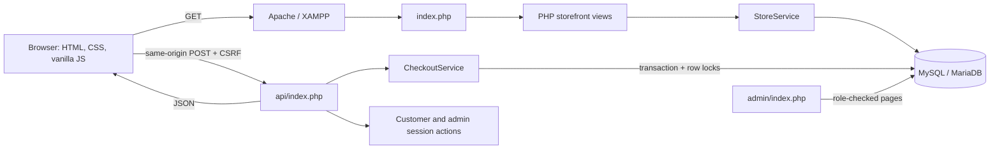
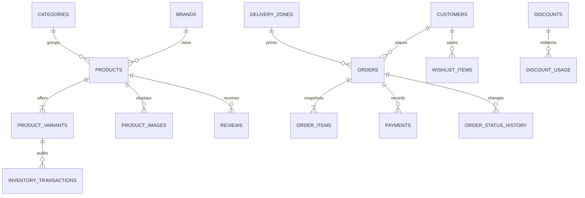

# Application architecture

## Request path

The app is server-rendered by PHP. `api/index.php` is the single same-origin JSON action endpoint for cart mutations, checkout, customer sessions, reviews, tracking, and staff updates. The browser's JavaScript progressively enhances forms; important totals, coupon eligibility, inventory, order state, and authorization are validated again on the server.

## Important modules

- `config/app.php` loads environment values and timezone; `config/database.php` creates the PDO MySQL connection.
- `includes/bootstrap.php` establishes session cookies and baseline security headers. `includes/functions.php` contains HTML escaping, CSRF, money, URL, and account helpers.
- `services/StoreService.php` provides prepared catalogue, category, delivery-zone, banner, and review queries.
- `services/CheckoutService.php` validates checkout input, re-prices from MySQL, locks selected rows, reserves stock, snapshots line items, applies discount constraints, records payment intent and order history, then commits atomically.
- `admin/index.php` and `admin/views/` provide the staff studio, including catalog/variant CRUD, image management, customer and guest-order lookup, homepage content, delivery, limited drops/pre-orders, sales reporting, and order details; `api/index.php` independently checks an admin session and CSRF token for mutations.
- `scripts/create-admin.php` is CLI-only and hashes passwords with PHP's password API. No seeded or default administrator exists.

## Data relationships

Orders retain customer, product, size, and price snapshots so later catalogue edits do not rewrite order history. Guest orders can be tracked only with the order number and matching normalized phone number. Variant stock and payment status are distinct: a submitted mobile-transfer ID remains pending until staff verifies it.

## State and safety invariants

1. Browser-supplied prices, delivery fees, product names, and discount values are never trusted at checkout; the service reloads these from the database.
2. A checkout token is unique per submission. MySQL row locks and conditional stock updates prevent overselling under concurrent orders.
3. Customer cancellation is limited to pending/confirmed orders inside the configured time window; staff may cancel pending/confirmed/processing orders. Cancellation restores only the stock movements recorded for that order, cancels reserved pre-orders, decrements sales counters, releases coupon usage, and closes pending mobile-payment verification.
4. Order statuses advance through `pending → confirmed → processing → shipped → delivered`; terminal `cancelled` and `delivered` states cannot be reopened through the endpoint.
5. Payment verification updates the payment and its order in one transaction. Refunds are not automated; handle them in the provider account before closing a paid order.
6. Customer and admin sessions use HTTP-only SameSite cookies, session ID rotation, and per-form CSRF tokens. All dynamic HTML output is escaped and SQL values are parameterized.

## Smoke and manual test matrix

Run `php tests/smoke.php` after importing the schema. The script verifies connection, expected tables, seeded items, active variants/zones, and every local product-image path.

| Flow | Check |
| --- | --- |
| Browse | Search, gender/category filters, sort, product notes, and size/stock options load from the database. |
| Cart | Add a size, change quantity (1–10), remove it, and check the header count and recalculated totals. |
| WhatsApp inquiry | Change size and quantity on a product, then open its WhatsApp link and confirm the message has the current variant and totals. Repeat from the bag and confirm every line item appears; the message must state that checkout is required to place an order. |
| Checkout | Try invalid phone, inactive zone, empty cart, oversell, invalid coupon, and a successful COD checkout. |
| Mobile payment | Submit a bKash/Nagad transaction ID; it remains pending until staff approves or rejects it. |
| Idempotency | Submit the same checkout token twice; only one order and stock deduction should exist. |
| Tracking | The order number with a wrong phone must reveal no order; the matching phone returns status history and line items. |
| Account | Register, sign in/out, inspect order history, and submit a review only for a delivered purchase. |
| Staff | Anonymous actions are rejected; test product/variant CRUD, image MIME/size rejection, visibility toggles, inventory history, guest/registered customer search, payment verification and COD collection, allowed order transitions, cancellation/restock, coupon scopes and limits, review moderation, homepage/delivery/drop settings, and CSV reports. |
| Responsive/accessibility | Test 390px and 1280px viewports, keyboard navigation, visible focus, labels, reduced motion preferences, and screen-reader names. |

The current checkout is a local demo/integration boundary: it collects mobile-money transaction IDs but does not verify them against a provider API, send email/SMS, or initiate refunds. Configure a provider integration before treating those statuses as live payments.
