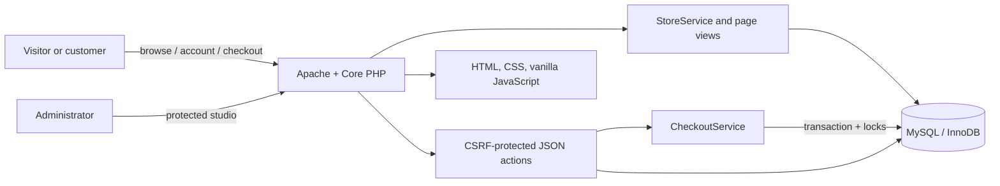
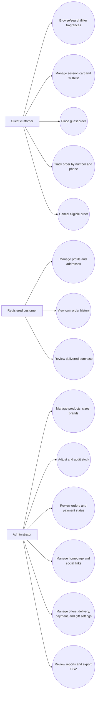
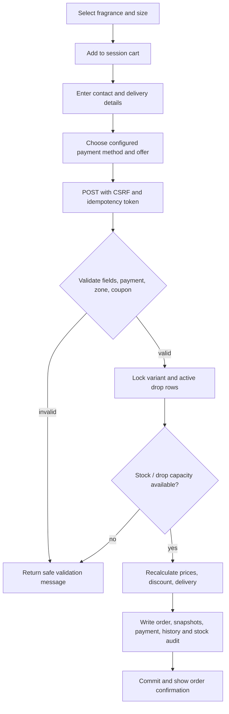
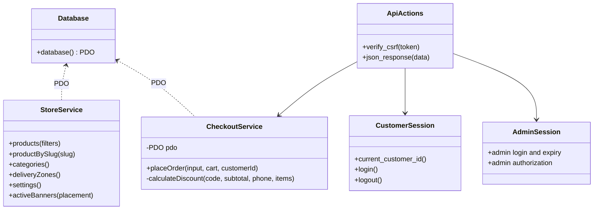
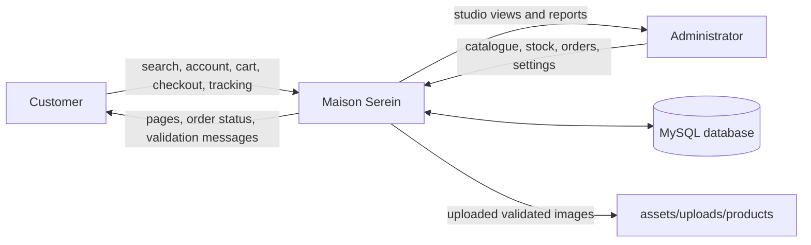

# Maison Serein — Software Engineering Documentation

## Project overview

Maison Serein is a server-rendered perfume storefront and staff studio for XAMPP. It uses Core PHP, PDO, MySQL/MariaDB, HTML, CSS, and vanilla JavaScript. Customers can browse and order as guests; optional customer accounts support saved addresses, wishlist synchronization, and order history. Staff authentication is separate from customer authentication.

### Problem statement

Small fragrance sellers need one reliable workflow for presenting catalogues with multiple sizes and prices, accepting guest orders, validating delivery and stock, tracking manual mobile-money payments, and keeping fulfilment information private. Spreadsheet and messaging-only workflows make inventory, order totals, and payment verification difficult to audit.

### Objectives

- Provide a responsive, database-driven storefront and shop collections.
- Preserve variant pricing and stock as products change.
- Support guest checkout, optional customer accounts, order lookup, and eligible cancellations.
- Recalculate prices, discounts, delivery fees, and stock on the server.
- Give authorized staff tools for catalogue, inventory, order, content, offer, payment, and report management.
- Run locally under XAMPP without a JavaScript build or PHP framework.

## Software requirements specification

### Functional requirements

1. Public visitors can search/filter fragrances, view product notes and reviews, choose an available size, and maintain a session cart and guest wishlist.
2. Customers can register/sign in, manage account addresses, review their own orders, submit a review after a delivered purchase, and track a guest or account order using order number plus phone.
3. Checkout validates contact and delivery fields, selected payment method, delivery zone, coupon rules, and current stock. A unique idempotency token prevents duplicate order writes.
4. bKash/Nagad submissions remain pending manual verification. COD remains unpaid until staff records cash collection. No payment gateway is simulated.
5. Staff can authenticate independently, manage products and variants, upload validated product images, manage category/brand visibility, adjust stock with an audit trail, review orders/payments, moderate reviews, configure delivery/payment/gift/cancellation settings, manage homepage banners/social links, offers, drops and pre-orders, and review sales/inventory reports.
6. Order changes are recorded in status history. Eligible cancellations restore only stock recorded as deducted by that order and release coupon use.

### Non-functional requirements

- Security: PDO prepared statements, output escaping, CSRF validation, password hashing, session ID rotation, session idle expiry for staff, server-side validation, upload MIME checks, file size caps, protected admin pages, and baseline response headers.
- Integrity: InnoDB foreign keys, unique order/idempotency identifiers, immutable order-item price snapshots, transactional stock movement, and non-negative inventory checks.
- Accessibility: semantic headings, explicit labels, keyboard focus visibility, accessible form messages, and responsive layouts.
- Maintainability: modular services, separate storefront/admin views, and repeatable SQL seed plus smoke test.
- Portability: PHP 8.1+ and MySQL 8+/MariaDB 10.6+ with required PHP extensions.

## Architecture and data model

`index.php` routes customer pages to views and `StoreService`; `api/index.php` accepts same-origin POST actions after CSRF checks; `CheckoutService` owns transactional order placement; `admin/index.php` protects and renders studio views. PDO connects to MySQL/MariaDB. See [ARCHITECTURE.md](ARCHITECTURE.md) for the ER diagram and request flow. Main records include admins, customers/addresses, categories, brands, products/images/variants, orders/items/payments/history, inventory transactions, discounts/usage, reviews, wishlists, homepage content, social links, delivery zones, settings, drops/pre-orders, notifications, activity logs, and newsletter subscribers.



## Use-case diagram



## Main workflows

### Guest checkout activity



### Checkout sequence

```mermaid
sequenceDiagram
  actor C as Customer
  participant UI as Storefront
  participant API as api/index.php
  participant S as CheckoutService
  participant DB as MySQL
  C->>UI: Submit checkout form
  UI->>API: POST checkout.create + CSRF + idempotency token
  API->>S: placeOrder(input, session cart, optional customer id)
  S->>DB: Begin transaction; check token and current settings
  S->>DB: Lock delivery zone, product variants, active drops
  S->>DB: Recalculate stock, product-scoped discounts, and totals
  S->>DB: Insert order snapshots, payment state, history, inventory movement
  DB-->>S: Commit
  S-->>API: Order number and total
  API-->>UI: JSON success and redirect
```

### Class diagram



## Data-flow and API

### Level-0 data flow



### JSON API conventions

`api/index.php` accepts POST only. Every request includes the session `csrf` token. Responses contain `ok`, a user-safe `message`, and optionally `redirect`, `reload`, `cart_count`, or returned order data. Unauthenticated admin actions return 401; invalid input is returned as 422; internal database errors are logged server-side and return a generic 500 response.

| Action family | Actions | Access |
| --- | --- | --- |
| Cart and wishlist | `cart.add`, `cart.update`, `cart.change-variant`, `cart.remove`, `wishlist.toggle` | Session / customer |
| Checkout and tracking | `checkout.create`, `track.lookup`, `track.cancel`, `discount.apply`, `discount.remove` | Guest or customer session; tracking also checks phone |
| Customer account | `customer.register`, `customer.login`, `customer.logout`, `customer.profile.update`, `customer.address.save`, `customer.address.delete`, `customer.address.default` | Customer |
| Reviews and newsletter | `review.submit`, `newsletter.subscribe` | Customer / public newsletter form |
| Admin catalog | `admin.product.save`, `admin.product.visibility`, `admin.product.active`, `admin.variant.save`, `admin.variant.toggle`, `admin.category.save`, `admin.category.toggle`, `admin.brand.save`, `admin.brand.toggle` | Admin session |
| Admin operations | `admin.order.update`, `admin.payment.update`, `admin.stock.adjust`, `admin.customer.toggle`, `admin.notification.read`, `admin.review.moderate` | Admin session |
| Admin configuration | `admin.discount.save`, `admin.discount.toggle`, `admin.profile.update`, `admin.password.change`, `admin.setting.save`, `admin.banner.save`, `admin.social.save`, `admin.section.toggle`, `admin.delivery.save`, `admin.drop.save`, `admin.preorder.update`, `admin.section.save` | Admin session |

## Installation and operator manuals

Follow [INSTALLATION.md](INSTALLATION.md) for XAMPP setup, SQL import, `.env`, CLI administrator provisioning, and smoke checks.

### Customer manual

1. Open the storefront and browse/search or select a collection.
2. Open a fragrance, choose a size, and add it to the bag. The displayed price and stock belong to that variant.
3. Continue to checkout as a guest or sign in to use saved addresses.
4. Choose a configured payment option. For bKash/Nagad, submit the transaction ID and wait for manual verification; COD remains unpaid until cash is collected.
5. Save the confirmation order number. Track with that number and the phone used at checkout. Eligible pending/confirmed orders show a cancellation option within the configured window.
6. Signed-in customers can view order history and review eligible delivered purchases.

### Administrator manual

1. Create the first administrator with `scripts/create-admin.php` from the local PHP CLI; no seeded password is provided.
2. Sign in at `/admin/index.php?page=login`. Sessions expire after 30 minutes of inactivity.
3. Use Fragrance to create products, upload images, edit metadata, manage sizes/prices, and hide or deactivate listings. Use Inventory for audited stock changes.
4. Use Orders to search/filter orders, inspect detail/history, move through allowed statuses, verify mobile payments, or mark COD cash collected.
5. Configure delivery zones, accepted payment methods, cancellation rules, gift mode, homepage content, collections, houses, offers, limited drops, and pre-orders in the matching studio pages.
6. Use Reports for date-bounded sales and inventory summaries and CSV export. Verify the exported values against the selected range before using them for accounting.

## Testing and report status

Run `php tests/smoke.php` after importing the schema. Use the manual test matrix in [ARCHITECTURE.md](ARCHITECTURE.md) for checkout, authorization, payment verification, cancellation, image upload, and responsive checks. This repository has not been tested against a live MySQL instance in the v0 workspace; the smoke test must be run in the configured XAMPP environment before presenting the build as locally verified.

## Known boundaries and assumptions

- bKash/Nagad are manual transaction-ID workflows; the app does not call payment-provider APIs, send SMS/email, or automatically issue refunds.
- Order cancellation is restricted to pending/confirmed customer orders within the configured hour window. Staff may cancel before shipment according to the order-state transition rules.
- A product-specific offer applies only to matching product line totals. Minimum purchase is evaluated against eligible products for a product-scoped offer.
- Product uploads are limited to five images per submission, JPG/PNG/WebP, 5 MB each. Web server permissions must allow writing to the upload folder.
- Store values and sample catalogue entries are demonstration defaults. Replace contact numbers, payment numbers, delivery charges, and sample content before live operation.
